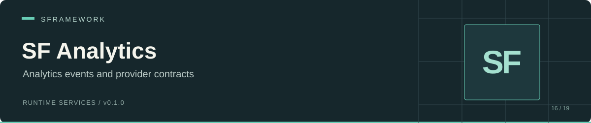

# SF Analytics

[Documentation website](https://docs.secretplace.studio/#sf-analytics)

 

SF Analytics sends a custom event to each provider you register with `ISFAnalyticsService`. An event contains an ID and string parameters. The included `SFAnalyticsProvider` logs the ID through `SFDebug`; your application supplies adapters for any analytics SDK or backend.

Use it to keep gameplay event creation separate from provider SDK calls, send one event to several adapters, or inspect event IDs through a registered logger.

[Install](#install) · [Use](#use) · [Provider adapter](#provider-adapter) · [API](#api) · [Limitations](#limitations)

## Install

In Unity Package Manager, select **Add package from git URL** and enter:

```text
https://github.com/huran438/sf-analytics.git#main
```

The [manifest](package.json) declares no dependencies. Install these separately:

| Requirement | Reason |
| --- | --- |
| [SF Core](https://github.com/huran438/sf-core) | `ISFService`, registration, injection, and `SFDebug`. |
| [SF Debug](https://github.com/huran438/sf-debug) | Assembly dependency of SF Core. |
| [UniTask](https://github.com/Cysharp/UniTask) | Service initialization returns `UniTask`. |

Your code assembly must reference `SFramework.Analytics.Runtime` and the SF assemblies it uses. The package itself has no provider SDK dependency or provider configuration asset. Install and configure your selected SDK in your application when writing an adapter.

`package.json` lists Unity `2019.4`, while the source and SF Core use newer C# and Unity APIs. Treat that value as package metadata; no supported editor floor was verified here.

## Use

Save this as `AnalyticsContext.cs` and add it to your startup scene. The context registers the service and its logging provider, then sends an event after service initialization. Register a logger because the provider sends output to `SFDebug`, not to Unity's logger directly.

```csharp
using System.Collections.Generic;
using System.Threading;
using Cysharp.Threading.Tasks;
using SFramework.Analytics.Runtime;
using SFramework.Core.Runtime;
using UnityEngine;

public sealed class AnalyticsContext : SFContextRoot
{
    private ISFAnalyticsService _analytics;

    protected override void PreInit()
    {
        SFDebug.RegisterLogger(Debug.unityLogger);
    }

    protected override void Bind()
    {
        _analytics = SFContainer.Register<ISFAnalyticsService, SFAnalyticsService>();
        _analytics.RegisterProvider(new SFAnalyticsProvider());
    }

    protected override UniTask Init(CancellationToken cancellationToken)
    {
        _analytics.SendCustomAnalyticsEvent(new LevelCompletedEvent("arena"));
        return UniTask.CompletedTask;
    }
}

public sealed class LevelCompletedEvent : ISFAnalyticsEvent
{
    public string Id => "level_completed";
    public Dictionary<string, string> Params { get; }

    public LevelCompletedEvent(string levelId)
    {
        Params = new Dictionary<string, string> { { "level_id", levelId } };
    }
}
```

The service starts with an empty provider list. `RegisterProvider` returns the service, so you can chain registrations. SF Core awaits `Init(CancellationToken)` in registration order; the analytics implementation returns `UniTask.CompletedTask` and performs no SDK startup.

For another controller, resolve `ISFAnalyticsService` after the context has bound it, or inject it through `[SFInject]` on an `ISFInjectable` class. Await the context's initialization when your provider requires application startup to finish before sending.

## Provider adapter

Implement `ISFAnalyticsProvider` to bridge the event into your SDK. This complete example formats the parameters for Unity's logger; replace its method body with your SDK call when creating an adapter.

```csharp
using System.Linq;
using SFramework.Analytics.Runtime;
using UnityEngine;

public sealed class ParameterLogProvider : ISFAnalyticsProvider
{
    public void SendCustomAnalyticsEvent(ISFAnalyticsEvent analyticsEvent)
    {
        var parameters = string.Join(", ", analyticsEvent.Params.Select(p => p.Key + "=" + p.Value));
        Debug.Log(analyticsEvent.Id + ": " + parameters);
    }

    public void Dispose() { }
}
```

Register this adapter with `analytics.RegisterProvider(new ParameterLogProvider())`. Each provider receives the same event object in registration order. Keep parameter conversion and any SDK-specific naming rules inside the adapter.

For dependency-aware event classes, inherit `SFAnalyticsEvent` instead of implementing the interface. Its base constructor calls SF Core injection, and its `Params` property contains a mutable dictionary. Construct such events after registering their dependencies. Injection runs before the derived constructor body, so injected methods must not depend on work that body performs.

## API

All types use `SFramework.Analytics.Runtime`.

| Type / signature | Behavior |
| --- | --- |
| `ISFAnalyticsService.RegisterProvider(ISFAnalyticsProvider analyticsProvider)` returning `ISFAnalyticsService` | Appends a provider and returns the service. |
| `void ISFAnalyticsService.SendCustomAnalyticsEvent<T>(T analyticsEvent) where T : ISFAnalyticsEvent` | Calls each non-null provider synchronously. |
| `UniTask SFAnalyticsService.Init(CancellationToken cancellationToken)` | Completes immediately; does not initialize providers. |
| `void SFAnalyticsService.Dispose()` | Empty implementation. |
| `string ISFAnalyticsEvent.Id { get; }` | Event identifier. |
| `Dictionary<string, string> ISFAnalyticsEvent.Params { get; }` | String parameter map. |
| `void ISFAnalyticsProvider.SendCustomAnalyticsEvent(ISFAnalyticsEvent analyticsEvent)` | Adapter's event entry point. |
| `void ISFAnalyticsProvider.Dispose()` | Provider cleanup contract inherited from `IDisposable`. The service does not invoke it. |
| `SFAnalyticsEvent` | Abstract injectable event base with abstract `Id` and an initialized `Params` dictionary. |
| `SFAnalyticsProvider` | Included logger; logs the event ID and does not inspect parameters. |

`ISFAnalyticsService` extends `ISFService`, which extends `ISFInjectable` and `IDisposable`. The generic send method does not construct an event; pass an existing event instance.

## Limitations

- SF Analytics supplies dispatch and a logger, with no built-in remote delivery, buffering, retry, persistence, consent flow, batching, or flush API. An adapter must implement whatever its target SDK requires.
- Registration accepts duplicates and null entries. Sending skips null providers, but duplicate registrations receive duplicate calls. The service has no unregister method.
- Sending does not catch provider exceptions. If one provider throws, later providers do not receive that send. Add error handling inside adapters when you need independent delivery.
- The service passes the event and its mutable dictionary by reference. Provider mutations can affect later providers. Treat the payload as read-only during dispatch or copy it in your adapter.
- The service does not validate a null event, ID, or parameter values. Validate data before sending according to your chosen provider's requirements.
- Service disposal does not dispose providers or clear the list. Your application owns provider cleanup and must prevent sends after adapter shutdown.

If the included provider produces no output, verify `SFDebug.RegisterLogger` and provider registration. Its log confirms that the dispatch method ran; it provides no remote delivery acknowledgment. For missing events at a backend, inspect your adapter and SDK response path.

## Source and related modules

[Service](Runtime/SFAnalyticsService.cs) · [Service interface](Runtime/ISFAnalyticsService.cs) · [Event interface](Runtime/ISFAnalyticsEvent.cs) · [Event base](Runtime/SFAnalyticsEvent.cs) · [Provider interface](Runtime/ISFAnalyticsProvider.cs) · [Logging provider](Runtime/SFAnalyticsProvider.cs) · [Assembly](Runtime/SFramework.Analytics.Runtime.asmdef)

[SF Core](https://github.com/huran438/sf-core) provides registration and injection; [SF Debug](https://github.com/huran438/sf-debug) supplies the core's debug assembly dependency.

Documentation reflects source snapshot `969050c62873f840fb3e804f7153aa2567f7ee42`. API and dependency checks were static; no Unity compile, play-mode run, SDK integration, or remote event delivery was performed.

## License

MIT. See [LICENSE.md](LICENSE.md) for the terms.
